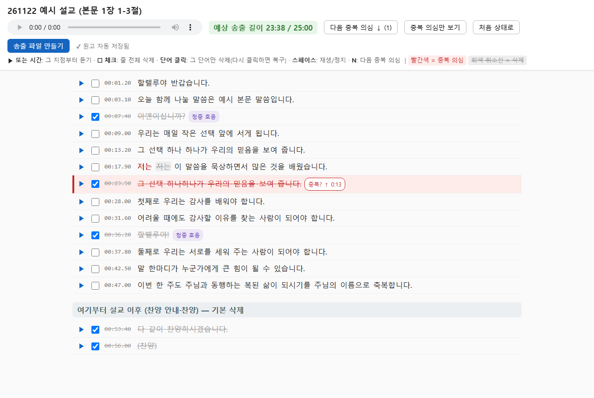
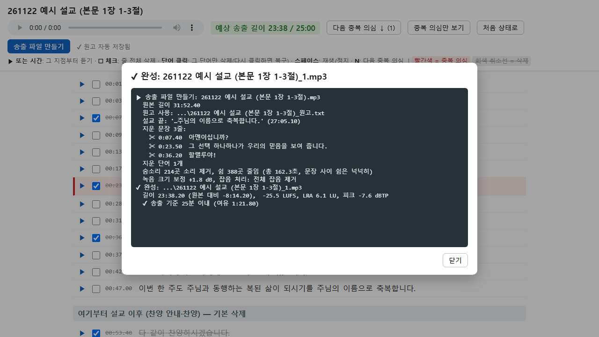

# FEBC 설교 편집기

주일 설교 녹음(MP3)을 **극동방송 송출 기준**에 맞게 다듬어 주는 도구입니다.
MP3 파일을 아이콘 위로 끌어다 놓으면 받아쓰기 원고가 만들어지고, 브라우저 편집 화면에서 지울 곳을 고른 뒤 버튼 하나로 송출용 `_1.mp3` 를 만듭니다.



> 스크린샷은 예시 데이터로 만든 화면입니다.

---

## 무엇을 자동으로 해 주나요

| 항목 | 처리 방법 |
|---|---|
| 앞부분 | 첫 말소리 1초 전부터 시작하고, 맨 앞에 2초 무음 추가 |
| 끝부분 | 설교 마지막 "…주님의 이름으로 축복합니다" 다음의 찬양·기도 안내와 찬양을 삭제 (끝 2초 무음) |
| 청중 호응 | "아멘이십니까?", "할렐루야" 같은 줄은 기본으로 삭제 표시 |
| 숨소리 | 자동으로 찾아 소리만 12dB 줄임 (시간은 그대로 두어 호흡 리듬 유지) |
| 쉼 | 문장 사이 쉼은 85% (0.6~1.2초), 문장 중간 쉼은 80% (최대 1.0초)로 줄임 |
| 잡음 | 전체에 일정하게 잡음 제거 (afftdn) |
| 음량 | 녹음 크기 보정 → 압축 → **-25.5 LUFS**, 피크 약 -7.5 dBFS |
| 형식 | MP3 192kbps / 48kHz / 스테레오 |
| 길이 | **25분 이내**인지 확인하고, 넘으면 경고 |

사람이 직접 고르는 것: 말실수, 다시 말한 부분, "어/음" 같은 추임새, 중복 문장.

---

## 설치 (처음 한 번)

1. **Python 3.12** 설치 — 설치 화면에서 *Add python.exe to PATH* 를 꼭 체크하세요.
2. 이 폴더에서 명령 프롬프트를 열고 필요한 패키지 설치:
   ```
   pip install -r requirements.txt
   ```
   - `imageio-ffmpeg` 가 ffmpeg 를 함께 내려받으므로 ffmpeg 를 따로 설치할 필요가 없습니다.
   - 처음 받아쓰기를 할 때 음성인식 모델(Whisper small, 약 500MB)을 자동으로 내려받습니다.
3. 이 저장소를 내려받아 원하는 폴더에 둡니다. (예: `바탕화면\FEBC설교\_도구`)
4. 편하게 쓰려면 `설교편집.bat` 의 **바로 가기**를 바탕화면에 만들어 두세요.

---

## 매주 사용법

### 1단계 — MP3 끌어다 놓기

원본 설교 MP3를 `설교편집.bat` (또는 바로 가기) 아이콘 위로 **끌어다 놓습니다**.

- **처음 여는 설교**: 받아쓰기를 합니다 (30분 설교 기준 약 5분). 끝나면 같은 폴더에 다음 파일이 생기고 편집 화면이 브라우저에 열립니다.
  - `원본_원고.txt` — 받아쓰기 원고 (편집 상태가 여기에 저장됨)
  - `원본_편집.html` — 편집 화면 데이터
- **편집하던 설교**: 받아쓰기 없이 저장된 상태 그대로 편집 화면이 다시 열립니다.

> ⚠ 검은 명령 창이 **편집 서버**입니다. 편집이 끝날 때까지 닫지 마세요. 닫으면 편집 화면이 멈춥니다.

### 2단계 — 편집 화면에서 지울 곳 고르기

| 하고 싶은 일 | 방법 |
|---|---|
| 그 지점부터 듣기 | 줄 앞의 **▶** 또는 **시간**을 클릭 |
| 재생 / 정지 | **스페이스바** |
| 줄 전체 지우기 | 줄 앞 **☐ 체크** (다시 누르면 복구) |
| 단어 하나만 지우기 | **단어 클릭** → 회색 취소선 (다시 클릭하면 복구) |
| 단어 지우고 바로 확인 | 단어 **더블클릭** → 지우고 1.5초 앞부터 재생 |
| 중복 의심 줄 차례로 보기 | **다음 중복 의심 ↓** 버튼 또는 **N** 키 |
| 중복 의심 줄만 모아 보기 | **중복 의심만 보기** |
| 모든 표시 되돌리기 | **처음 상태로** |

화면의 표시:

- **빨간 줄** — 앞에 나온 줄과 비슷한 **중복 의심** 줄입니다. 오른쪽 `중복? ↑ 0:13` 표시를 누르면 비슷한 줄로 이동합니다. `다시 말함? →` 은 말을 시작했다가 처음부터 다시 말한 경우입니다.
- **빨간 굵은 단어** — "저는 저는" 처럼 바로 이어서 반복된 단어입니다.
- **청중 호응** 태그 — 기본으로 삭제 표시되어 있습니다. 살리려면 체크를 푸세요.
- **여기부터 설교 이후** 구분선 아래 — 찬양 안내·찬양으로, 송출 파일에서 빠집니다.
- 위쪽 **예상 송출 길이** — 지우는 대로 바로 바뀝니다. 25분을 넘으면 빨간색이 됩니다. (대략적인 값이며 정확한 길이는 만든 뒤 확인)

편집 내용은 **자동 저장**됩니다 (`✔ 원고 자동 저장됨`). 창을 닫았다가 다시 MP3를 끌어다 놓으면 이어서 편집할 수 있습니다.

### 3단계 — 송출 파일 만들기

**[송출 파일 만들기]** 를 누르면 1~2분 뒤 같은 폴더에 `원본_1.mp3` 가 만들어집니다.
이미 `_1.mp3` 가 있으면 `_2.mp3`, `_3.mp3` … 로 새로 만들고 기존 파일은 덮어쓰지 않습니다.



마지막 줄을 꼭 확인하세요.

- `✔ 송출 기준 25분 이내` → 극동방송에 보내면 됩니다.
- `⚠ 경고: 송출 기준 25분을 … 초과` → 편집 화면에서 더 지우고 다시 만드세요.

설교 끝 위치를 자동으로 못 찾으면 `(확인 필요)` 가 표시됩니다. 이때는 편집 화면 끝부분의 구분선 위치를 들어 보고 확인하세요.

---

## 명령줄로 쓰기

```
python febc_edit.py --edit "원본.mp3"            # 편집 화면 열기 (설교편집.bat 과 같음)
python febc_edit.py --script "원본.mp3"          # 원고와 편집 화면 파일만 만들기
python febc_edit.py --script --force "원본.mp3"  # 원고를 처음부터 다시 만들기
python febc_edit.py "원본.mp3"                   # 편집 화면 없이 바로 송출 파일 만들기
python febc_edit.py "원본_원고.txt"              # 원고 기준으로 송출 파일 만들기
python febc_edit.py "원본.mp3" -o "결과.mp3"     # 결과 파일 이름 지정
```

### 원고 파일을 메모장으로 직접 고치기

`원본_원고.txt` 를 메모장으로 열어 고칠 수도 있습니다.

```
[00:03.10 ~ 00:06.85] 오늘 함께 나눌 말씀은 …
# [00:07.40 ~ 00:08.20] 아멘이십니까?  ← 청중 호응
```

- 지울 줄은 맨 앞에 `# ` 을 붙이고, 살릴 줄은 `#` 을 지웁니다.
- **줄 자체를 지우지 마세요.** `[ ]` 안의 시간도 그대로 두세요. 글자 오타는 고쳐도 됩니다.
- 맨 아래 `======== 단어 삭제 ========` 목록은 편집 화면에서 클릭해 지운 단어입니다.

---

## 파일 구성

| 파일 | 설명 |
|---|---|
| `febc_edit.py` | 본체: 받아쓰기, 원고 생성, 편집 서버, 송출 파일 생성 |
| `editor_template.html` | 브라우저 편집 화면 |
| `설교편집.bat` | MP3를 끌어다 놓으면 편집 화면을 여는 실행 파일 |
| `requirements.txt` | 필요한 Python 패키지 목록 |
| `gemini_review.py` | (실험 중) Gemini 로 편집 제안 받기 — 아직 편집 화면에 연결되어 있지 않음 |
| `.env.example` | Gemini API 키 설정 예시. `.env` 로 복사해 키를 넣으세요 (`.env` 는 GitHub 에 올라가지 않음) |

## 세부 조정

`febc_edit.py` 위쪽 **튜닝 값** 부분에서 바꿀 수 있습니다.

| 값 | 기본 | 뜻 |
|---|---|---|
| `SENT_KEEP` / `SENT_MIN` / `SENT_MAX` | 0.85 / 0.6 / 1.2 | 문장 사이 쉼 유지 비율·최소·최대(초) |
| `PAUSE_KEEP` / `PAUSE_MAX` | 0.80 / 1.0 | 문장 중간 쉼 유지 비율·최대(초) |
| `BREATH_ATTEN_DB` | 12 | 숨소리를 줄이는 양(dB) |
| `PAD_START` / `PAD_END` | 2.0 / 2.0 | 앞뒤에 넣는 무음(초) |
| `TARGET_LUFS` | -25.5 | 최종 음량 |
| `MAX_LEN_SEC` | 1500 | 송출 길이 기준(25분) |
| `ASR_MODEL` | small | 음성인식 모델 (medium 은 더 정확하지만 느림) |

## 문제 해결

| 증상 | 해결 |
|---|---|
| 끌어다 놓아도 창이 바로 닫히거나 `python` 을 찾을 수 없음 | Python 설치 때 *Add to PATH* 를 체크했는지 확인 |
| `✖ 자동 저장 실패` | 검은 명령 창(편집 서버)이 닫혔습니다. MP3를 다시 끌어다 놓으세요 |
| `편집 서버를 열 수 없습니다 (포트 사용 중)` | 이전 편집 창이 여러 개 열려 있습니다. 모두 닫고 다시 시도 |
| 편집 화면에서 소리가 안 나옴 | 원본 MP3를 옮기거나 이름을 바꾸지 않았는지 확인 |
| 설교 끝이 잘못 잡힘 | 편집 화면에서 구분선 근처 줄의 체크를 직접 바꾸세요 |

편집 서버는 이 PC 안(`127.0.0.1`)에서만 접속되며, 설교 음성은 외부로 보내지 않습니다.
